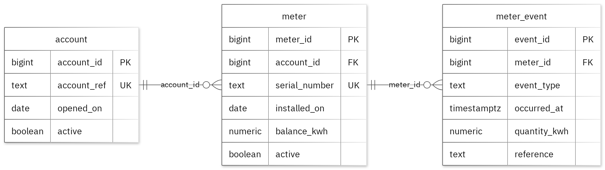

# MIT 8103 Advanced Database Systems

**Prepaid Electricity Metering** · Idris Musa · Student ID 301917184

## Case study

My case study is Prepaid Electricity Metering. I designed the database for utility account administrators, metering operations staff and customers reviewing meter activity, with separate tables named account, meter and meter_event. It supports these operations: register an account and its meters; record positive energy-credit or energy-consumption events and update the meter balance in the same transaction; benchmark filtering meter events by occurrence date with 50000 synthetic event rows, comparing an unindexed filter plan with a B-tree index plan; record plans and row counts without assuming performance results.

## Portfolio 1: Database Design and Modelling

I organised the relational design into 3 tables. Primary keys identify records, foreign keys preserve the links, and checks enforce the stated business rules. A meter's available energy balance must never be below zero. The normalisation examples show the sample data at 1NF, 2NF and 3NF. All 11 deliberately invalid inserts were rejected without changing the valid sample rows.

Figure 1. Tables, keys and relationships. PK: primary key; FK: foreign key; UK: unique value.

<!-- PAGE BREAK -->

## Portfolio 2: Query Processing and Optimisation

I ran three SQL queries against the sample records. The join returned 1 rows and included ACCT-SYN-001 with MTR-SYN-001. For the index comparison, I used 50,000 separate performance rows. The median lookup time changed from 2.274 ms to 0.298 ms. Both phases returned the same records. The measured plan used the new index. These timings apply to this lookup and environment.

## Portfolio 3: Transactions and Concurrency

I used a temporary counter on meter to test COMMIT, ROLLBACK and READ COMMITTED isolation. The uncommitted update remained hidden from the other session, and ROLLBACK restored the earlier committed value. Without locking, two increments left the counter at 2. With SELECT FOR UPDATE, Session B waited for Session A and the final value was 3. The helper is confined to this exercise; the case's original business fields stay unchanged.

## Portfolio 4: NoSQL and Advanced Data Models

I used meter_event_stream for the case's event documents. MongoDB inserted 2 sample events and returned the expected results for 4 queries. Validation rejected an invalid date type and a duplicate event ID. Embedded snapshots keep related details with an event, while the details field can differ by event type. These are fictional events; PostgreSQL continues to enforce its relational rules.

## Repository and evidence

https://github.com/idrismusa4/Musa_Idris_301917184

The portfolio folders contain the SQL and JavaScript, explanations, query plans, result tables and screenshots.

<!-- PAGE BREAK -->

## Portfolio 5: Distributed and Cloud Database Exercise

I proposed three MongoDB replica members across separate failure zones. The discussion covers primary elections, majority acknowledgement, secondary lag and sharding trade-offs for meter_event_stream. Replication supports availability, while backups address recovery. PostgreSQL needs its own availability plan. This is the permitted discussion option; no live replica set or failover test was deployed.

## Individual reflection

I kept account, meter, meter_event in separate tables so their details could be maintained without repeating them in every related record. A meter's available energy balance must never be below zero. The constraint tests check this alongside the required values and record links. One issue illustrated by the two-session exercise is that both sessions can read the same value before either update is committed. Locking the row before reading preserves both increments. The index comparison also shows why I need to check the execution plan as well as the final answer: the same result can require different amounts of database work.

## AI-use declaration

I used GitHub Copilot to help prepare the database model, scripts and explanations.

## References

- [PostgreSQL: constraints](https://www.postgresql.org/docs/17/ddl-constraints.html)
- [PostgreSQL: EXPLAIN](https://www.postgresql.org/docs/17/using-explain.html)
- [PostgreSQL: isolation](https://www.postgresql.org/docs/17/transaction-iso.html)
- [PostgreSQL: row locks](https://www.postgresql.org/docs/17/explicit-locking.html)
- [MongoDB: data modelling](https://www.mongodb.com/docs/manual/data-modeling/)
- [MongoDB: replication](https://www.mongodb.com/docs/manual/replication/)
- [MongoDB: sharding](https://www.mongodb.com/docs/manual/sharding/)
- [Mermaid: ER diagrams](https://mermaid.js.org/syntax/entityRelationshipDiagram.html)

